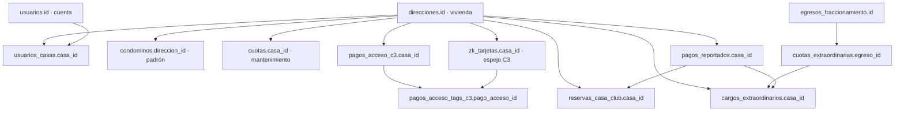

# Mapa SQL por sección y relaciones — Misión Jardines

Auditoría de modelos, rutas y servicios del **18/oct/2026**. Son **consultas de diagnóstico equivalentes** a los datos que consume cada módulo; Sequelize puede generar SQL distinto. No se consultó MySQL de Hostinger ni el controlador físico. El esquema real se debe corroborar antes de ejecutar, especialmente columnas creadas en despliegues recientes.

## 0. Safe mode: iniciar aquí (solo lecturas)

En MySQL Workbench abrir una sesión de diagnóstico con usuario limitado a `SELECT`, seleccionar **manualmente la base correcta** y ejecutar:

```sql
SET SESSION SQL_SAFE_UPDATES = 1;
SET SESSION TRANSACTION ISOLATION LEVEL READ COMMITTED;
START TRANSACTION READ ONLY;
SELECT DATABASE() AS base_actual, CURRENT_DATE() AS fecha_servidor;
SET @casa_id := 1;    -- Sustituir por direcciones.id VERIFICADO, no por el número postal.
SET @usuario_id := 1; -- Sustituir por usuarios.id si se requiere.
```

Al finalizar: `ROLLBACK;` (libera la transacción de solo lectura). Todas las consultas siguientes son `SELECT`, `SHOW` o `DESCRIBE`. **No ejecutar** `UPDATE`, `DELETE`, `ALTER`, `TRUNCATE`, `SET FOREIGN_KEY_CHECKS=0` ni «reparaciones» masivas durante el diagnóstico. `SQL_SAFE_UPDATES` no sustituye respaldos ni permisos de solo lectura.

Primero cotejar columnas reales; no repetir un `ALTER` que ya existe (`egreso_id` en `cuotas_extraordinarias` puede estar creado):

```sql
SHOW TABLES;
SHOW CREATE TABLE direcciones;
SHOW CREATE TABLE cuotas;
SHOW CREATE TABLE pagos_reportados;
SHOW CREATE TABLE cuotas_extraordinarias;
SHOW CREATE TABLE cargos_extraordinarios;
SHOW CREATE TABLE pagos_manuales_concepto;
SHOW CREATE TABLE reservas_casa_club;
SHOW CREATE TABLE zk_tarjetas;
SHOW CREATE TABLE pagos_acceso_c3;
SHOW CREATE TABLE pagos_acceso_tags_c3;
```

## 1. Relaciones maestras (no confundir las entidades)



No hay equivalencia automática entre `condominos` (padrón de personas), `usuarios` (cuentas para iniciar sesión), `direcciones` (vivienda) y TAGs (acceso físico). `usuarios.casa_id` es legado: la pertenencia vigente se valida también con `usuarios_casas` y su indicador `activo`.

```sql
-- Viviendas y cuentas vinculadas: no mostrar secretos, teléfonos ni correos.
SELECT d.id AS casa_id, d.calle, d.numero,
       COUNT(DISTINCT uc.usuario_id) AS cuentas_vinculadas,
       COUNT(DISTINCT c.id) AS residentes_activos,
       COUNT(DISTINCT z.id) AS tags_asociados
FROM direcciones d
LEFT JOIN usuarios_casas uc ON uc.casa_id=d.id AND uc.activo=1
LEFT JOIN condominos c ON c.direccion_id=d.id AND c.activo=1
LEFT JOIN zk_tarjetas z ON z.casa_id=d.id AND z.en_controlador=1
WHERE d.id=@casa_id
GROUP BY d.id,d.calle,d.numero;

-- El padrón oficial de 231 no es sinónimo de todas las filas de direcciones.
SELECT COUNT(*) AS registros_direcciones FROM direcciones;
SELECT calle,numero,COUNT(*) AS duplicados FROM direcciones
GROUP BY calle,numero HAVING COUNT(*)>1;
SELECT COUNT(*) AS tags_sin_casa FROM zk_tarjetas WHERE casa_id IS NULL;
SELECT z.id,z.casa_id FROM zk_tarjetas z
LEFT JOIN direcciones d ON d.id=z.casa_id
WHERE z.casa_id IS NOT NULL AND d.id IS NULL LIMIT 50;
```

## 2. Login, Registro, Mi cuenta, Verificación y Auto-users

Tablas: `usuarios`, `roles`, `solicitudes_cuenta`, `verificaciones_cuenta`, `solicitudes_rol`, `usuarios_casas`, `historial_vinculos`, `invitaciones_casa`, `auto_users_invitaciones`, `auto_users_reportes`.

```sql
SELECT u.id,u.estatus,u.cuenta_aceptada,u.sesion_version,r.nombre AS rol
FROM usuarios u JOIN roles r ON r.id=u.rol_id
WHERE u.id=@usuario_id;

SELECT casa_id,tipo,activo,vinculado_en,desvinculado_en FROM usuarios_casas
WHERE usuario_id=@usuario_id ORDER BY vinculado_en DESC;

SELECT id,tipo_cuenta,estatus,casa_sugerida_id,creado_en,revisado_en
FROM solicitudes_cuenta WHERE usuario_id=@usuario_id ORDER BY id DESC;

SELECT id,accion,tipo,casa_id,creado_en FROM historial_vinculos
WHERE usuario_id=@usuario_id ORDER BY id DESC LIMIT 30;

-- NO seleccionar token_hash ni contrasena_hash ni códigos de verificación.
SELECT usuario_id,envio_estado,expira_en,enviado_en FROM auto_users_invitaciones
WHERE usuario_id=@usuario_id;

SELECT usuario_id,estatus,creado_en,corregido_en
FROM auto_users_reportes WHERE usuario_id=@usuario_id ORDER BY id DESC;

SELECT casa_id,tipo,creado_en,expira_en,aceptado_en,revocado_en
FROM invitaciones_casa WHERE casa_id=@casa_id ORDER BY id DESC LIMIT 25;
```

Interconexión: sesión/rol se autentican primero; `usuarios_casas` determina qué `direcciones.id` puede usar el cliente. Revocar el acceso invalida versiones de sesión, pero **no borra** cuotas ni TAGs.

## 3. Viviendas, residentes y búsqueda general

Tablas: `direcciones`, `condominos`, `usuarios_casas` y, según recurso buscado, `cuotas`, `visitas_programadas`, `accesos_seguridad`, `calendario` y `pagos_reportados`.

```sql
SELECT id,calle,calle_correcta,numero,en_renta FROM direcciones
WHERE id=@casa_id;

SELECT id,direccion_id,activo,origen_importacion_id,fecha_registro
FROM condominos WHERE direccion_id=@casa_id ORDER BY id;

SELECT d.id,d.calle,d.numero FROM direcciones d
WHERE d.calle LIKE '%Guadalajara%' ORDER BY d.calle,d.numero LIMIT 50;

SELECT usuario_id,casa_id,tipo,activo FROM usuarios_casas WHERE casa_id=@casa_id;
```

**Diferencia:** gestionar residentes edita `condominos`, no otorga cuentas ni confirma un pago. Búsqueda aplica **filtros de permisos en la API** además de SQL; un SELECT en Workbench por sí solo no simula el filtrado por rol.

## 4. Pagos de mantenimiento: cuotas, OCR, recargos, diario C3

Tablas: `cuotas`, `pagos_reportados` (`tipo_pago='MANTENIMIENTO'`), `recargos_mantenimiento`, `pagos_acceso_c3`, `pagos_acceso_tags_c3`, `folios_consecutivos`, `zk_tarjetas`.

```sql
SELECT id,anio,mes,estatus_pago,monto_cuota,monto_pagado,recargo,saldo_pendiente,
       fecha_pago,referencia,folio
FROM cuotas WHERE casa_id=@casa_id ORDER BY anio,FIELD(mes,
'ENERO','FEBRERO','MARZO','ABRIL','MAYO','JUNIO','JULIO','AGOSTO','SEPTIEMBRE','OCTUBRE','NOVIEMBRE','DICIEMBRE');

SELECT id,tipo_pago,estatus,folio_reporte,folio_operacion,fecha_operacion,
       monto,monto_requerido,recargo,creado_en
FROM pagos_reportados WHERE casa_id=@casa_id AND tipo_pago='MANTENIMIENTO'
ORDER BY id DESC LIMIT 50;

SELECT casa_id,corte,pago_id,monto FROM recargos_mantenimiento
WHERE casa_id=@casa_id ORDER BY corte DESC;

SELECT id,clave_movimiento,origen,origen_id,meses,estado,intentos,
       saldo_antes_centavos,saldo_despues_centavos,proximo_intento,error
FROM pagos_acceso_c3 WHERE casa_id=@casa_id ORDER BY id DESC;

SELECT t.pago_acceso_id,t.tarjeta_id,t.numero_tarjeta,t.fecha_antes,t.fecha_despues,
       t.estado,t.error
FROM pagos_acceso_tags_c3 t JOIN pagos_acceso_c3 e ON e.id=t.pago_acceso_id
WHERE e.casa_id=@casa_id ORDER BY t.id DESC;
```

**Importante:** el saldo de mantenimiento de la UI **no** es `SUM(saldo_pendiente)` sin más. `adeudo-vivienda-analisis.service.js` calcula desde septiembre 2026, incluyendo mensualidades sin fila en SQL, abonos y recargos por corte del 10. La **fecha de acceso** la entrega el C3 real y no se reconstruye de `cuotas` ni `vigencias_mantenimiento`. Los datos de OCR/comprobante se excluyen deliberadamente de estas consultas.

## 5. Cuotas extraordinarias (egreso → proyecto → 231 viviendas → pago)

Tablas: `egresos_fraccionamiento`, `cuotas_extraordinarias`, `cargos_extraordinarios`, `pagos_reportados`, `pagos_manuales_concepto`.

```sql
SELECT e.id,e.fecha,e.categoria,e.concepto,e.monto,e.referencia,
       ce.id AS proyecto_id,ce.monto_total,ce.meses,ce.fecha_inicio,ce.viviendas,ce.activo
FROM egresos_fraccionamiento e
LEFT JOIN cuotas_extraordinarias ce ON ce.egreso_id=e.id
WHERE e.categoria='CUOTA_EXTRAORDINARIA'
ORDER BY e.fecha DESC,e.id DESC LIMIT 100;

SELECT c.id,c.casa_id,c.cuota_extraordinaria_id,c.periodo,c.monto,
       ce.concepto,ce.activo
FROM cargos_extraordinarios c
JOIN cuotas_extraordinarias ce ON ce.id=c.cuota_extraordinaria_id
WHERE c.casa_id=@casa_id ORDER BY c.periodo,c.id;

-- Diagnóstico de cargos: el pago se considera confirmado por VALIDADO o manual.
SELECT c.id,c.periodo,c.monto,
       CASE
         WHEN EXISTS(SELECT 1 FROM pagos_manuales_concepto m
                     WHERE m.cargo_extraordinario_id=c.id) THEN 'PAGADO_MANUAL'
         WHEN EXISTS(SELECT 1 FROM pagos_reportados p
                     WHERE p.cargo_extraordinario_id=c.id AND p.estatus='VALIDADO') THEN 'PAGADO_VALIDADO'
         WHEN EXISTS(SELECT 1 FROM pagos_reportados p
                     WHERE p.cargo_extraordinario_id=c.id AND p.estatus='PENDIENTE_VALIDACION') THEN 'EN_REVISION'
         ELSE 'PENDIENTE' END AS estado_diagnostico
FROM cargos_extraordinarios c JOIN cuotas_extraordinarias ce
  ON ce.id=c.cuota_extraordinaria_id AND ce.activo=1
WHERE c.casa_id=@casa_id ORDER BY c.periodo,c.id;

-- Cada proyecto nuevo debe conciliarse contra 231 * meses y total EXACTO.
SELECT ce.id,ce.concepto,ce.monto_total,ce.meses,ce.viviendas,
       COUNT(c.id) AS cargos_generados,COUNT(DISTINCT c.casa_id) AS viviendas_cobradas,
       ROUND(SUM(c.monto),2) AS total_distribuido
FROM cuotas_extraordinarias ce LEFT JOIN cargos_extraordinarios c
  ON c.cuota_extraordinaria_id=ce.id
GROUP BY ce.id,ce.concepto,ce.monto_total,ce.meses,ce.viviendas ORDER BY ce.id DESC;

SELECT cuota_extraordinaria_id,casa_id,periodo,COUNT(*) AS veces
FROM cargos_extraordinarios GROUP BY cuota_extraordinaria_id,casa_id,periodo
HAVING COUNT(*)>1;
```

No repetir `ADD COLUMN egreso_id`: ante error MySQL 1060 usar `SHOW COLUMNS FROM cuotas_extraordinarias;` y confrontar el script `backend/sql/2026-10-18-cuotas-extraordinarias-casa-club.sql`. Para cobrar un proyecto el backend exige **exactamente 231** viviendas seleccionadas por padrón; jamás repartir automáticamente entre todas las filas de `direcciones` sin cotejo. Un pago extraordinario **no genera** evento de extensión de mantenimiento.

## 6. Casa club (reserva → aprobación → cargo → pago/cancelación)

Tablas: `reservas_casa_club`, `usuarios`, `direcciones`, `pagos_reportados`, `pagos_manuales_concepto`.

```sql
SELECT r.id,r.casa_id,r.fecha,r.fecha_bloqueada,r.estatus,r.fecha_limite_pago,
       r.cuota_recuperacion AS renta,r.deposito_garantia AS deposito,r.limpieza,
       (r.cuota_recuperacion+r.deposito_garantia+r.limpieza) AS total,
       r.pagado,r.fecha_pago,r.folio
FROM reservas_casa_club r WHERE r.casa_id=@casa_id
ORDER BY r.fecha DESC,r.id DESC;

-- Solicitudes actuales a revisar sin exponer datos personales del solicitante.
SELECT id,casa_id,fecha,fecha_bloqueada,estatus,fecha_limite_pago,pagado
FROM reservas_casa_club WHERE estatus IN ('PENDIENTE','APROBADA')
ORDER BY fecha,id;

-- Reservas vencidas sin prueba de pago oportuno; candidatas a expiración de la API.
SELECT r.id,r.casa_id,r.fecha,r.fecha_limite_pago
FROM reservas_casa_club r
WHERE r.estatus='APROBADA' AND r.pagado=0 AND r.fecha_limite_pago<CURDATE()
AND NOT EXISTS(SELECT 1 FROM pagos_reportados p
  WHERE p.reserva_casa_club_id=r.id AND p.estatus IN ('PENDIENTE_VALIDACION','VALIDADO')
        AND p.fecha_operacion<=r.fecha_limite_pago);

SELECT id,reserva_casa_club_id,estatus,monto,fecha_operacion,folio_reporte
FROM pagos_reportados WHERE casa_id=@casa_id AND tipo_pago='CASA_CLUB'
ORDER BY id DESC;

SELECT id,reserva_casa_club_id,monto,forma_pago,creado_en
FROM pagos_manuales_concepto WHERE casa_id=@casa_id AND tipo_pago='CASA_CLUB'
ORDER BY id DESC;
```

La fecha queda PENDIENTE para otros desde `fecha_bloqueada`; APROBADA tiene costo/renta/depósito/limpieza; al vencer sin comprobante oportuno la API la CANCELA y libera fecha. La expiración corre al consultar/operar Casa club, **no con cron independiente**. La ausencia de pago de una reserva CANCELADA no sigue siendo deuda del solicitante.

## 7. Adeudos por tres conceptos y bloqueo de TAGs

La API `/api/pagos/adeudos` usa `adeudos-comunidad.service.js` (mantenimiento calculado en JS, extras por cargos activos y reservas Casa club APROBADAS no pagadas). `zkteco-adeudos.service.js` selecciona solo **deuda exigible para acceso**:

| Concepto | Regla para TAG | Origen | Cuándo deja de ser exigible |
| --- | --- | --- | --- |
| Mantenimiento | `periodo-10 < fecha actual de México`, monto pendiente > 0 | `cuotas` más meses faltantes calculados | Confirmación contable / condonación válida |
| Extraordinaria | `periodo <= mes actual`, cargo activo sin pago confirmado | `cargos_extraordinarios` | Comprobante VALIDADO o pago manual del cargo |
| Casa club | APROBADA no pagada, límite anterior a hoy, **sin comprobante EN_REVISION** | `reservas_casa_club` y `pagos_reportados` | Validación o cancelación por vencimiento; excepcionalmente revisión administrativa |

Diagnóstico rápido de **indicios SQL**, no suma contable oficial del servicio:

```sql
-- A. Mantenimiento: filas explícitas impagas (no detecta meses SIN fila).
SELECT casa_id,anio,mes,estatus_pago,monto_pagado,saldo_pendiente
FROM cuotas WHERE casa_id=@casa_id AND estatus_pago NOT IN ('PAGADO','CANCELADO','CONDONADO')
ORDER BY anio,mes;

-- B. Cargos extraordinarios del mes actual o anteriores sin pago confirmado.
SELECT c.id,c.casa_id,c.periodo,c.monto
FROM cargos_extraordinarios c JOIN cuotas_extraordinarias ce
  ON ce.id=c.cuota_extraordinaria_id AND ce.activo=1
WHERE c.casa_id=@casa_id AND c.periodo<=LAST_DAY(CURDATE())
AND NOT EXISTS(SELECT 1 FROM pagos_reportados p
  WHERE p.cargo_extraordinario_id=c.id AND p.estatus='VALIDADO')
AND NOT EXISTS(SELECT 1 FROM pagos_manuales_concepto m
  WHERE m.cargo_extraordinario_id=c.id);

-- C. Reservas APROBADAS con fecha límite vencida y aún sin pago.
SELECT id,casa_id,fecha_limite_pago,cuota_recuperacion,deposito_garantia,limpieza
FROM reservas_casa_club
WHERE casa_id=@casa_id AND estatus='APROBADA' AND pagado=0
  AND fecha_limite_pago<CURDATE();

-- D. TAGs de esa vivienda en el espejo SQL, NO prueba física suficiente.
SELECT id,casa_id,numero_tarjeta,en_controlador,bloqueado,fecha_inicio,fecha_fin,ultima_lectura
FROM zk_tarjetas WHERE casa_id=@casa_id ORDER BY id;

-- E. Incidencias físicas en operaciones anteriores.
SELECT id,accion,casa_id,tarjeta_id,error,created_at
FROM zk_error_logs WHERE casa_id=@casa_id ORDER BY id DESC LIMIT 30;
```

**Diferencias intencionales**: el servicio aplica hora de **America/Mexico_City**; `CURDATE()` usa la zona del servidor MySQL y puede diferir cerca de medianoche. El cálculo exacto de mantenimiento incluye meses *sin filas* y recargos, por lo que no existe un `SUM` fiable de las cuotas explícitas. Los comprobantes EN_REVISION de extraordinaria siguen siendo deuda hasta validarse; los comprobantes oportunos de Casa club no deben perjudicar al residente mientras Administración revisa.

**El C3-200 NO expone sus tablas físicas `user` y `userauthorize` en Hostinger/MySQL**. `zk_tarjetas` es espejo/cache; el bloqueo real retira `userauthorize` mediante el servicio TCP con verificación de lectura posterior. La vigencia EndTime no se «corta» al bloquear: se conserva. Jamás usar SQL `UPDATE zk_tarjetas SET bloqueado=1` como sustituto de bloquear físicamente.

Activación segura sin cambios de esquema: `ZKTECO_ADEUDOS_ENABLED=true`, primero `ZKTECO_ADEUDOS_DRY_RUN=true` con `ZKTECO_ADEUDOS_CASA_IDS=<ID_PILOTO>`; para escritura piloto, **ambos** `ZKTECO_DRY_RUN=false` y `ZKTECO_ADEUDOS_DRY_RUN=false`. Por defecto no se escribe nada. Para global `ZKTECO_ADEUDOS_GLOBAL_CONFIRMADO=CONFIRMO_231` exige cotejo del padrón. El monitor solo bloquea; después de liquidar, Administración debe habilitar manualmente para no remover bloqueos de seguridad.

## 8. Análisis de cuotas / Ingresos y egresos

Tablas: las anteriores más `egresos_fraccionamiento`. La tabla «Quién pagó» calcula por concepto; las gráficas deben usar ingresos confirmados, no pagos pendientes.

```sql
SELECT categoria,COUNT(*) AS movimientos,ROUND(SUM(monto),2) AS egresos
FROM egresos_fraccionamiento GROUP BY categoria ORDER BY categoria;

SELECT tipo_pago,estatus,COUNT(*) AS reportes,ROUND(SUM(monto),2) AS monto_reportado
FROM pagos_reportados GROUP BY tipo_pago,estatus ORDER BY tipo_pago,estatus;

SELECT tipo_pago,COUNT(*) AS cobros_manuales,ROUND(SUM(monto),2) AS importe
FROM pagos_manuales_concepto GROUP BY tipo_pago;

SELECT YEAR(fecha_pago) AS anio,MONTH(fecha_pago) AS mes,
       ROUND(SUM(cuota_recuperacion),2) AS renta,
       ROUND(SUM(deposito_garantia),2) AS deposito,
       ROUND(SUM(limpieza),2) AS limpieza
FROM reservas_casa_club WHERE pagado=1 AND fecha_pago IS NOT NULL
GROUP BY YEAR(fecha_pago),MONTH(fecha_pago) ORDER BY anio,mes;
```

No sumar sin más los reportes `VALIDADO` de Casa club con `reservas_casa_club.pagado`: un mismo cobro puede aparecer en ambos. Para el dato exacto de la gráfica usar `backend/src/services/resumen-conceptos-analisis.service.js` y controlador `finanzas.controller.js`. `Mantenimiento` puede registrar `cuotas` más movimientos de conceptos especiales y saldos iniciales: cotejar el agregador antes de inferir KPIs del `SUM` aislado.

## 9. Seguridad, visitas y QR

Tablas: `accesos_seguridad`, `visitas_programadas`, `permisos_acceso_vivienda`, `direcciones`, `usuarios`.

```sql
SELECT id,tipo,casa_id,fecha_entrada,fecha_salida,registrado_por_usuario_id
FROM accesos_seguridad WHERE casa_id=@casa_id ORDER BY id DESC LIMIT 30;

SELECT id,casa_id,tipo,fecha_programada,hora_programada,vigencia_hasta,
       estatus,fecha_entrada,fecha_salida FROM visitas_programadas
WHERE casa_id=@casa_id ORDER BY id DESC LIMIT 30;

SELECT casa_id,pluma,porton_1,porton_2,porton_3,actualizado_en
FROM permisos_acceso_vivienda WHERE casa_id=@casa_id;
```

El registro de acceso de Seguridad **no** modifica `zk_tarjetas` y el QR de una visita no cambia por sí solo `userauthorize` del C3. Los endpoints aplican controles de rol.

## 10. Calendario (distinto de Casa club)

```sql
SELECT id,titulo,casa_id,tipo_evento,visibilidad,estatus,
       fecha_inicio,fecha_fin,activo,creado_por_usuario_id
FROM calendario
WHERE activo=1 ORDER BY fecha_inicio DESC LIMIT 50;
```

La ruta de eventos comunitarios usa `calendario`; parte del Dashboard heredado todavía usa `eventos` en consultas SQL. **Comprobar** la existencia y la utilidad real de ambas tablas antes de proponer unificación; no mover datos a ciegas.

## 11. Conmutador, conexión y fuentes externas

```sql
-- Estado de existencia de integración, sin seleccionar campos secretos/valores.
SELECT COUNT(*) AS configuraciones FROM configuraciones_conexion;

-- Fuente heredada de teléfonos: confirmar columnas antes de consultar.
SHOW COLUMNS FROM condominos_importacion;
SELECT COUNT(*) AS registros_importados FROM condominos_importacion;
```

`/api/entorno/noticias` y `/api/entorno/incidencias` consumen web/RSS y TomTom: **no hay tabla de noticias ni de tráfico**. Las claves `TOMTOM_API_KEY` y (si aplica) `GOOGLE_MAPS_BROWSER_API_KEY` vienen del entorno, no se consultan por SQL. Telefonía depende de configuración de backend y del contenedor externo; `condominos_importacion` no se actualiza cuando se edita `condominos`.

## 12. Anuncios, Reportes, Directorio y Mapa

- `anuncios.html` y `reportes.html`/`reporte.html`: persisten actualmente en `localStorage` de navegador; **no hay queries SQL de sus fichas**.
- `directorio.html` y `mapa.html`: contenido definido en frontend; las páginas requieren la autenticación que corresponde, pero **no hay tabla propia** para catálogo editable.
- `docs/index.html` reúne datos de API de dashboard, noticias y tráfico (sección 11), pagos y solicitudes; es un consumidor de varias fuentes, no una tabla única.

## 13. Control operativo y conciliación final (solo lectura)

```sql
-- Reportes validados con alguna cuota C3 sin completar: revisión de acceso.
SELECT p.id,p.casa_id,p.folio_reporte,p.estatus,e.id AS evento_c3,e.estado,
       e.intentos,e.error
FROM pagos_reportados p
JOIN pagos_acceso_c3 e ON e.origen_id=p.id AND e.origen='PAGO'
WHERE p.estatus='VALIDADO' AND e.estado NOT IN ('COMPLETADO','SIN_TAGS')
ORDER BY e.id DESC LIMIT 100;

-- TAGs sin vivienda o en_controlador=0 necesitan diagnóstico físico, NO borrado.
SELECT id,casa_id,numero_tarjeta,en_controlador,bloqueado,ultima_lectura
FROM zk_tarjetas WHERE casa_id IS NULL OR en_controlador=0 ORDER BY id LIMIT 100;

-- Pistas sobre revisión bancaria; sin datos de OCR ni archivos adjuntos.
SELECT casa_id,tipo_pago,estatus,COUNT(*) AS reportes
FROM pagos_reportados GROUP BY casa_id,tipo_pago,estatus ORDER BY casa_id LIMIT 100;

-- Al terminar:
ROLLBACK;
```

**No se requieren columnas ni tablas nuevas para el monitor de bloqueo por adeudos de este PR.** Se reutilizan las tablas existentes. Si falta alguna, cotejar primero migraciones de `backend/sql/`, su servicio de esquema y `SHOW CREATE TABLE` — no ejecutar un `ALTER` repetido. La normalización de datos históricos y la auditoría del padrón requieren autorización y copia de seguridad aparte.

**Código de referencia:** `backend/src/services/adeudos-comunidad.service.js`, `adeudo-vivienda-analisis.service.js`, `cargos-extraordinarios.service.js`, `resumen-conceptos-analisis.service.js`, `zkteco-adeudos.service.js`, `zkteco-direct.service.js`, `zkteco-vigencias.service.js`; rutas en `backend/src/app.js`, pruebas en [PLAN_PRUEBAS_INTEGRAL_20261018.md](PLAN_PRUEBAS_INTEGRAL_20261018.md).
